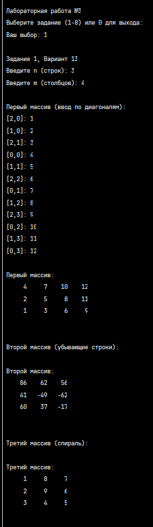
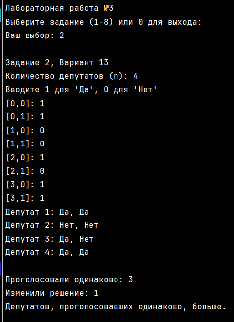
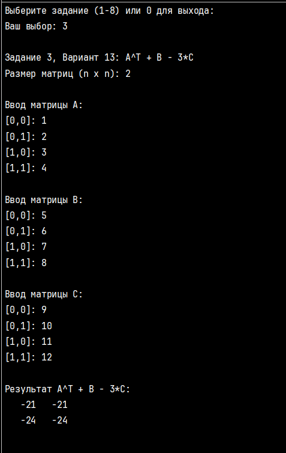
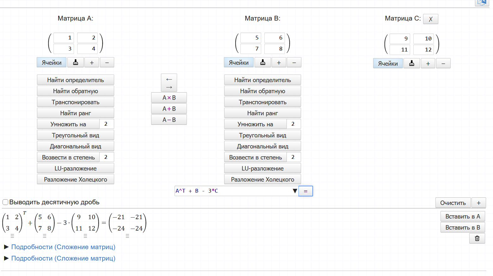
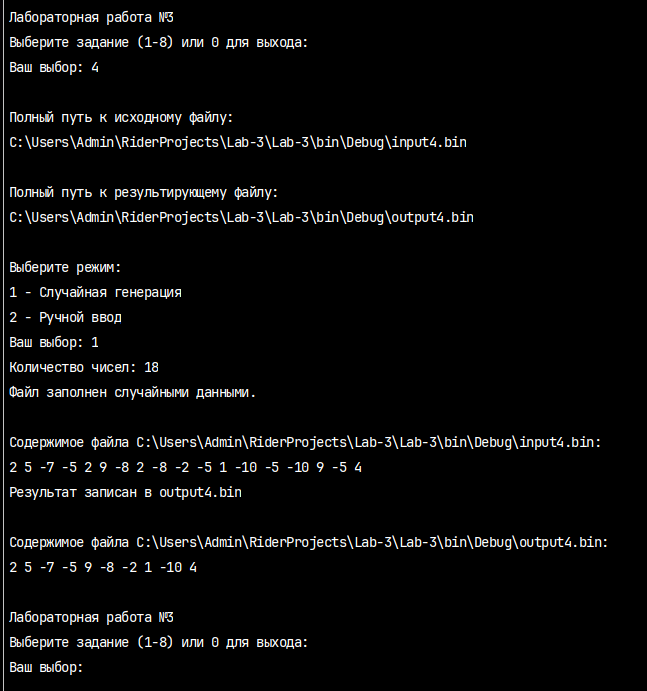
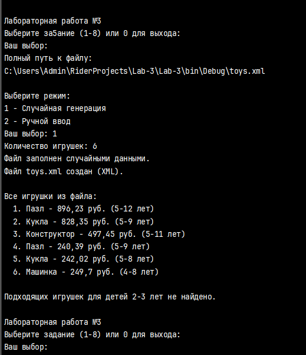
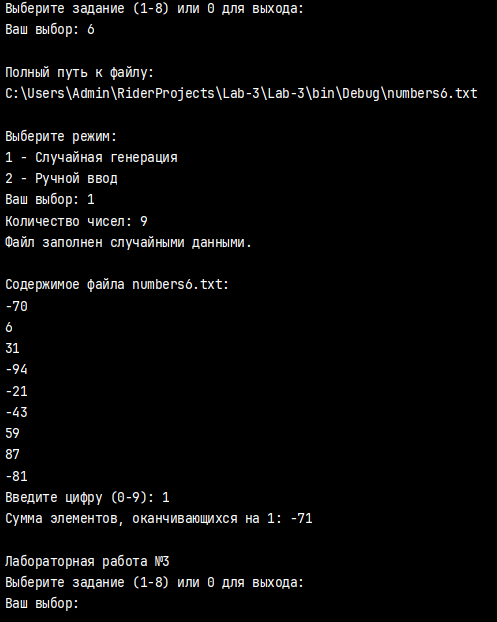
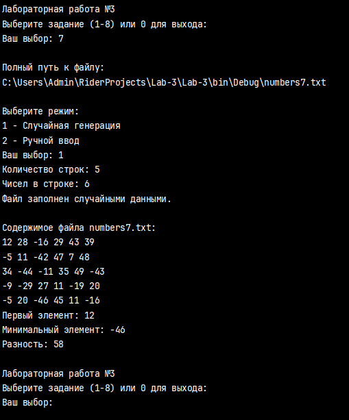
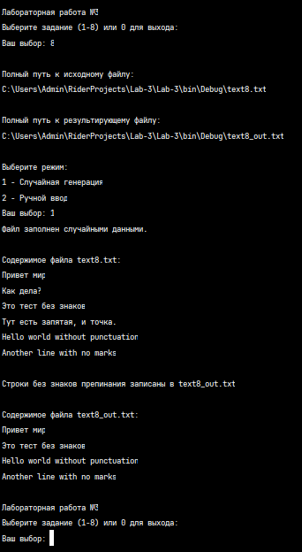

# Лабораторная работа №3 — Массивы и файлы

**Автор:** Чичарин Денис, ИТ-2

**Вариант:** 13

---

## Задание 1. Заполнение двумерных массивов

### Текст задачи

Первый массив, размерностью n x m, заполняется данными, вводимыми с клавиатуры, так что заполнение ведется по диагоналям параллельным главной, начиная с левого нижнего угла.

Второй массив, размерностью n x n, заполняется случайными числами так, что в каждой строке получается убывающая последовательность элементов.

Третий массив, размерностью n x n, заполняется для произвольного n так же, как для n=5:

```
1 16 15 14 13
2 17 24 23 12
3 18 25 22 11
4 19 20 21 10
5  6  7  8  9
 ```


### Алгоритм решения

1. Создан класс `MatrixClass` с единственным полем `_data` типа `int[,]` (двумерный массив) и полями `_rows`, `_cols` для хранения размерности.
2. Реализован конструктор `MatrixClass(int n, int m)` для первого массива: матрица заполняется по диагоналям, параллельным главной, начиная с левого нижнего угла. Используется переменная `diff = i - j`, меняющаяся от `n-1` до `-(m-1)`. Для каждой диагонали вычисляется диапазон строк через `Math.Max` и `Math.Min`, каждый элемент запрашивается у пользователя через `ConsoleHelper.ReadInt()`.
3. Реализован конструктор `MatrixClass(int n)` для второго массива: для каждой строки генерируются `n` случайных чисел через `Random.Next(-100, 100)`, затем они сортируются по убыванию методом пузырьковой сортировки (без LINQ) и записываются в матрицу.
4. Реализован конструктор `MatrixClass(int n, string mode)` для третьего массива: матрица заполняется числами от 1 до n² по спирали против часовой стрелки (вниз → вправо → вверх → влево). Используются четыре переменные-границы (`top`, `bottom`, `left`, `right`), которые сужаются после каждого прохода.
5. Переопределён метод `ToString()` для вывода матрицы в виде таблицы с использованием `PadLeft(6)` для выравнивания столбцов.
6. В методе `RunTask1()` запрашиваются размерности `n` и `m`, создаются три объекта `MatrixClass` через разные конструкторы и выводятся на экран.

### Тестирование

<p align="center">

</p>

---

## Задание 2. Работа с двумерными массивами

### Текст задачи

В двумерном массиве содержатся результаты двух голосований n депутатов. При голосовании требовалось ответить "Да" или "Нет". Подсчитайте каких депутатов больше: тех, кто оба раза проголосовал одинаково, или тех кто изменил свое решение.

### Алгоритм решения

1. В классе `MatrixClass` реализован метод `AnalyzeVoting()`, работающий с полем `_data` размерностью n×2.
2. Инициализированы два счётчика: `sameCount = 0` (депутаты, проголосовавшие одинаково) и `changedCount = 0` (депутаты, изменившие решение).
3. В цикле `for` происходит проход по всем строкам массива (каждая строка — один депутат).
4. Для каждой строки получаются значения из столбцов: `v1 = _data[i, 0]` (первое голосование) и `v2 = _data[i, 1]` (второе голосование). Число 1 означает "Да", 0 — "Нет".
5. С помощью тернарного оператора числа преобразуются в строки "Да"/"Нет" для вывода.
6. Сравниваются `v1` и `v2`: если равны — увеличивается `sameCount`, иначе — `changedCount`.
7. Выводится информация о каждом депутате и итоговые счётчики.
8. Счётчики сравниваются между собой, выводится результат: кого больше — проголосовавших одинаково, изменивших решение, или количество равно.
9. В методе `RunTask2()` запрашивается количество депутатов `n`, создаётся матрица n×2 через конструктор с ручным вводом (`manual = true`) и вызывается метод `AnalyzeVoting()`.

### Тестирование

<p align="center">

</p>

---

## Задание 3. Работа с двумерными массивами как с матрицами

### Текст задачи

Вычислить значение матричного выражения: **A^T + B − 3·C**

Перегрузить необходимые операторы и посчитать значение матричного выражения (решение без перегрузки не принимается). Перегрузить метод `ToString()` — сформировать строку из двумерного массива для отображения его на экране в виде таблицы. Приложить в отчёт скрин-шот проверки на онлайн-калькуляторе, чтобы показать, что выражение посчитано верно.

### Алгоритм решения

1. В классе `MatrixClass` перегружен унарный оператор `~` для транспонирования матрицы: создаётся новая матрица с размерностями `_cols × _rows`, в цикле меняются индексы местами: `result._data[j, i] = m._data[i, j]`.
2. Перегружен бинарный оператор `+` для сложения матриц: создаётся новая матрица того же размера, в цикле складываются соответствующие элементы: `result._data[i, j] = a._data[i, j] + b._data[i, j]`.
3. Перегружен бинарный оператор `-` для вычитания матриц по аналогии со сложением.
4. Перегружен бинарный оператор `*` для умножения матрицы на скаляр (в обоих направлениях: `matrix * scalar` и `scalar * matrix`): создаётся новая матрица, каждый элемент умножается на скаляр.
5. Все операторы создают новые объекты `MatrixClass` через конструктор с `manual = false`, чтобы не запрашивать ввод при промежуточных вычислениях.
6. Переопределён метод `ToString()` для вывода матрицы в виде таблицы.
7. В методе `RunTask3()` запрашивается размер матриц `n`, создаются три матрицы A, B, C через ручной ввод, вычисляется выражение `~A + B - 3 * C` в одну строку с использованием перегруженных операторов.
8. Результат выводится на экран и проверяется на онлайн-калькуляторе (matrixcalc.org).

### Тестирование

<p align="center">

</p>

<p align="center">

</p>

---

## Задание 4. Бинарные файлы

### Текст задачи

Из исходного файла получить новый файл, исключив повторные вхождения чисел. Порядок следования чисел сохранить.

### Алгоритм решения

1. В классе `FileTasks` реализован отдельный метод `FillBinaryRandom(string path, int count)` для заполнения исходного бинарного файла случайными числами через `BinaryWriter` и `Random.Next(-10, 10)` (диапазон выбран так, чтобы гарантировать повторы).
2. Реализован отдельный метод `FillBinaryManual(string path, int count)` для ручного ввода чисел.
3. В методе `Task4()` выводятся полные пути к файлам через `Path.GetFullPath()`.
4. Пользователю предлагается выбрать режим (1 — случайная генерация, 2 — ручной ввод) через метод `ChooseMode()` с валидацией ввода.
5. Все числа считываются из исходного файла через `BinaryReader.ReadInt32()` в цикле `while` до конца потока.
6. Для каждого числа проверяется, есть ли оно уже в списке уникальных чисел `List<int>`, используется линейный поиск в цикле `for` (без LINQ).
7. Если число не найдено — оно добавляется в список через `uniqueNumbers.Add(num)`.
8. Уникальные числа записываются в новый файл через `BinaryWriter` с сохранением порядка следования.
9. Содержимое обоих файлов выводится через вспомогательный метод `ReadBinaryFile()` для наглядной демонстрации результата.

### Тестирование

<p align="center">

</p>

---

## Задание 5. Бинарные файлы и структуры

### Текст задачи

Файл содержит сведения об игрушках: название игрушки, ее стоимость в рублях и возрастные границы (например, игрушка может предназначаться для детей от двух до пяти лет). Получить название самой дорогой игрушки, подходящей детям двух-трех лет.

### Алгоритм решения

1. На верхнем уровне файла объявлена структура `Toy` с модификатором `public` (обязательно для `XmlSerializer`): поля `Name` (string), `Price` (double), `AgeMin` (int), `AgeMax` (int).
2. Реализован отдельный метод `FillToysRandom(string path, int count)` для генерации случайных игрушек: выбирается случайное название из массива, случайная цена через `Math.Round(rnd.NextDouble() * 1000, 2)`, случайные возрастные границы.
3. Реализован отдельный метод `FillToysManual(string path, int count)` для ручного ввода игрушек.
4. Используется XML-сериализация (обязательное условие): создаётся `XmlSerializer` для типа `List<Toy>`, список сериализуется в файл через `StreamWriter`.
5. В методе `Task5()` предлагается выбор режима заполнения, вызывается соответствующий метод, выводится полный путь к файлу.
6. Файл десериализуется обратно в `List<Toy>` через `StreamReader` и `XmlSerializer.Deserialize()`.
7. Все игрушки из файла выводятся для наглядности.
8. Находится самая дорогая игрушка, подходящая для детей 2-3 лет: условие `t.AgeMin <= 2 && t.AgeMax >= 3` (игрушка должна подходить и для 2-летнего, и для 3-летнего ребёнка).
9. Выводятся название, цена и возрастной диапазон найденной игрушки, либо сообщение "Подходящих игрушек не найдено".

### Тестирование

<p align="center">

</p>

---

## Задание 6. Текстовые файлы

### Текст задачи

В текстовом файле хранятся целые числа по одному в строке. Найти сумму элементов, оканчивающихся на заданную цифру.

### Алгоритм решения

1. Реализованы отдельные методы `FillText6Random` и `FillText6Manual` для заполнения файла случайными числами или вручную (по одному числу в строке через `StreamWriter.WriteLine()`).
2. В методе `Task6()` предлагается выбор режима, файл заполняется, его содержимое выводится через `ReadTextFile()`.
3. У пользователя запрашивается цифра от 0 до 9 через `ConsoleHelper.ReadInt()`.
4. Файл считывается построчно через `StreamReader.ReadLine()` в цикле `while`.
5. Каждая строка преобразуется в число через `int.TryParse()`.
6. Последняя цифра числа определяется как `Math.Abs(num) % 10`. Использование `Math.Abs()` обязательно для корректной работы с отрицательными числами (например, `-12` оканчивается на 2, а не на -2).
7. Если последняя цифра равна введённой — число добавляется к сумме `sum += num`.
8. Выводится итоговая сумма.

### Тестирование

<p align="center">

</p>

---

## Задание 7. Решить задачу с использованием структуры «текстовый файл»

### Текст задачи

В текстовом файле хранятся целые числа по несколько в строке. Найти разность первого и минимального элементов.

### Алгоритм решения

1. Реализованы отдельные методы `FillText7Random` и `FillText7Manual` для заполнения файла случайными числами или вручную (по несколько чисел в строке через пробел).
2. В методе `Task7()` запрашиваются количество строк и чисел в строке, файл заполняется, его содержимое выводится.
3. Инициализированы переменные `firstElement = 0`, `minElement = 0` и флаг `isFirst = true` для отслеживания первого элемента.
4. Файл считывается построчно, каждая строка разбивается на части через `line.Split(' ')`.
5. Каждая часть преобразуется в число через `int.TryParse()`.
6. Если это первый элемент файла (`isFirst == true`) — он записывается в `firstElement` и `minElement`, устанавливается `isFirst = false`.
7. Иначе — если число меньше текущего минимума, обновляется `minElement`.
8. Выводятся первый элемент, минимальный элемент и их разность `firstElement - minElement`.

### Тестирование

<p align="center">

</p>

---

## Задание 8. Текстовый файл

### Текст задачи

В файле хранится произвольный текст. Переписать в другой файл строки, в которых нет знаков препинания.

### Алгоритм решения

1. Реализованы отдельные методы `FillText8Random` и `FillText8Manual` для заполнения файла текстом.
2. В методе `Task8()` определена строка со знаками препинания: `".,!?;:-—«»()[]{}"`.
3. Предлагается выбор режима заполнения, выводятся полные пути к исходному и результирующему файлам.
4. Выводится содержимое исходного файла через `ReadTextFile()`.
5. Исходный файл открывается на чтение, результирующий — на запись одновременно через `using`.
6. Для каждой строки исходного файла проверяется каждый символ в цикле `for`: если `punctuation.IndexOf(line[i]) >= 0`, значит знак препинания найден.
7. Если ни одного знака препинания не найдено (`hasPunctuation == false`) — строка записывается в результирующий файл через `writer.WriteLine(line)`.
8. Выводится содержимое результирующего файла для наглядной демонстрации результата.

### Тестирование

<p align="center">

</p>

---

## Ссылка на репозиторий

[GitHub: Lab-3](https://github.com/0RockManson0/Lab-3)